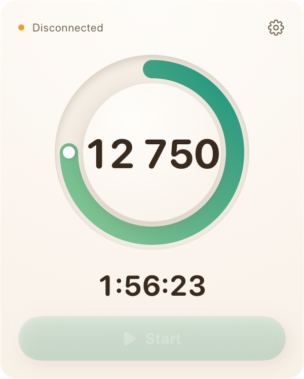
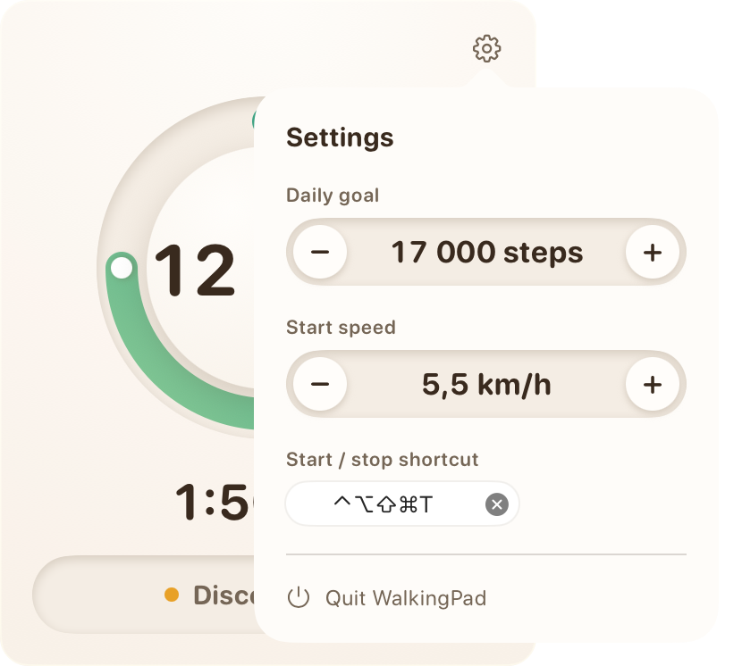

# walkingpad-menubar

A small macOS menu bar app for the KingSmith WalkingPad. It shows today's step count next to the clock, starts and stops the belt, and keeps a daily tally on your Mac.

<p align="center">
  <br><br>
  
  
</p>

## What it does

- Today's steps in the menu bar, in bold.
- A ring that fills up toward your daily goal. Past 100 % it keeps going round for a second lap, like the Apple Watch rings.
- Today's active walking time.
- One button to start and stop the belt. When the pad isn't connected, the button is replaced by the connection status.
- A global keyboard shortcut that does the same as the button, so you can stop the belt without opening the panel.
- Settings for the daily goal (1,000 to 50,000 steps), the speed the belt starts at (0.5 to 6 km/h) and the shortcut.

Totals are kept per day in `~/Library/Application Support/WalkingPad/activity.json`. The day rolls over at midnight. If you walk while the app isn't running, it catches up from the pad's own counters the next time it connects.

## Supported hardware

Tested on a WalkingPad A1 Pro, which advertises itself as `KS-ST-A1P` (firmware `M30_V187.2.2`). The app looks for devices whose name starts with `KS-` or `WalkingPad`, so other models that speak the same protocol may work, but none has been tried.

## Build

You need macOS 14 or later and Xcode.

```sh
./make-app.sh
open build/WalkingPad.app
```

The script builds a release binary with `xcodebuild`, wraps it in `build/WalkingPad.app` and signs it. If you have an "Apple Development" certificate it uses that, otherwise it signs ad hoc. With a stable certificate, macOS keeps the Bluetooth permission across rebuilds; with ad hoc signing it asks again after each build.

macOS asks for Bluetooth access on first launch. The app lives in the menu bar only, with no Dock icon.

Run the tests with `swift test`.

## Protocol notes

The pad exposes service `FE00`. Commands are written to `FE02` (write without response) and status frames come back as notifications on `FE01`.

Frames look like `F7 <payload> <sum of payload mod 256> FD`:

| Command | Payload |
|---|---|
| Ask for status | `A2 00 00` |
| Set mode (1 manual, 2 standby) | `A2 02 <mode>` |
| Set speed | `A2 01 <km/h × 10>` |
| Start belt | `A2 04 01` |

A status reply is 20 bytes starting with `F8 A2`. Byte 2 is the belt state (1 running, 9 start countdown), byte 3 the speed, byte 4 the mode, bytes 5 to 7 the elapsed time in seconds, 8 to 10 the distance in hundredths of a km and 11 to 13 the step count.

The pad drops commands sent less than about 0.7 s apart, so the app polls every 700 ms and queues your last action between polls.

Starting the belt means switching to manual mode, sending start, then setting the speed once the belt reports it's running. Stopping puts the pad back in standby.

## Disclaimer

This is an unofficial project, not affiliated with or endorsed by KingSmith.
